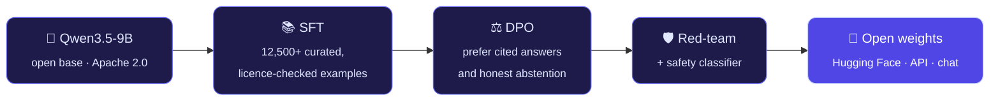

  
  
  
  
  

 

Most AI assistants sound confident even when they're wrong. At **[SORAEN](https://soraenai.netlify.app)** I'm building models that
answer from evidence, cite the source behind every claim, and say *"I don't know"* when the answer isn't there.

> [!NOTE]
> **SORAEN Lite is in development.** Want to try it first? [Join the early-access waitlist →](https://soraenai.netlify.app)

 

## ◆ See it in action

  

 

## ◆ How SORAEN Lite is made

 

## ◆ Principles

<table>
  <tr>
    <td width="50%" valign="top">
      <h4>🔎 Evidence over guesswork</h4>
      A correct <i>"the documents don't say"</i> beats a fluent guess.
    </td>
    <td width="50%" valign="top">
      <h4>📏 Honest evaluation</h4>
      Decontaminated benchmarks. Results published, losses included.
    </td>
  </tr>
  <tr>
    <td width="50%" valign="top">
      <h4>🛡️ Safety before shipping</h4>
      A model ships only if it is not less safe than its base.
    </td>
    <td width="50%" valign="top">
      <h4>🌐 Open by default</h4>
      Weights, model cards and evaluation methods are public.
    </td>
  </tr>
</table>

 

## ◆ Toolkit

  

  
  
  
  
  

 

## ◆ Activity

  <picture>
    <source media="(prefers-color-scheme: dark)" srcset="https://github-readme-stats.vercel.app/api?username=arxanshxh2309&show_icons=true&count_private=true&include_all_commits=true&hide_border=true&bg_color=0d1117&title_color=a5b4fc&icon_color=818cf8&text_color=c9d1d9&rank_icon=github" />
    
  </picture>
  <picture>
    <source media="(prefers-color-scheme: dark)" srcset="https://github-readme-stats.vercel.app/api/top-langs/?username=arxanshxh2309&layout=compact&langs_count=6&hide_border=true&bg_color=0d1117&title_color=a5b4fc&text_color=c9d1d9" />
    
  </picture>

  <picture>
    <source media="(prefers-color-scheme: dark)" srcset="https://raw.githubusercontent.com/arxanshxh2309/arxanshxh2309/output/snake-dark.svg" />
    
  </picture>

  
<b>What I'm working on right now</b>

   

  - [x] Curate and licence-check the SFT dataset (12,500+ examples)
  - [x] Grounded answering with page-level citations
  - [ ] Preference optimisation (DPO) for citing and abstaining
  - [ ] Red-team pass and safety classifier
  - [ ] Open-weights release on Hugging Face + hosted API

 

  Building something with grounded AI, or want early access? <a href="mailto:founder.soraen.ai@gmail.com">Let's talk</a>.

