<p align="center">
  <a href="https://www.linkedin.com/in/aryan-shah-864860419/"></a>
  <a href="https://x.com/arxanshxh2309"></a>
  <a href="https://www.instagram.com/2309arxan/"></a>
  <a href="https://soraenai.netlify.app"></a>
  <a href="https://huggingface.co/soraenai"></a>
  <a href="mailto:founder.soraen.ai@gmail.com"></a>
</p>

<p align="center">
  
</p>

<br />

<p align="center">
  
</p>

<br />

## ⟡ Right now

<table>
  <tr>
    <td width="33%" valign="top" align="center">
      <h3>🛠️</h3>
      <b>Building</b><br />
      <sub><a href="https://soraenai.netlify.app">SORAEN</a>, an AI lab training models that cite their sources</sub>
    </td>
    <td width="33%" valign="top" align="center">
      <h3>🧠</h3>
      <b>Learning</b><br />
      <sub>LLM fine-tuning, multi-agent systems, alignment &amp; AI security</sub>
    </td>
    <td width="33%" valign="top" align="center">
      <h3>📐</h3>
      <b>Balancing</b><br />
      <sub>Class 11 PCM + JEE 2028 prep + a startup</sub>
    </td>
  </tr>
</table>

<br />

## ⟡ What I'm building

<table>
  <tr>
    <td width="110" align="center" valign="middle">
      <a href="https://soraenai.netlify.app"></a>
    </td>
    <td valign="middle">
      <h3>SORAEN Lite &nbsp;</h3>
      A grounded, multimodal language model that answers from evidence, cites the source behind every claim,
      and says <i>"I don't know"</i> instead of guessing.
      <br /><sub>Fine-tuned from Qwen3.5-9B · SFT + DPO on 12,500+ curated examples · image &amp; voice input · red-team tested · open weights</sub>
      <br /><br /><a href="https://soraenai.netlify.app"><b>Join the early-access waitlist →</b></a>
    </td>
  </tr>
</table>

<p align="center">
  
</p>

<details>
  <summary><b>How SORAEN Lite is trained</b></summary>
  <br />


</details>

<br />

## ⟡ What I'm into

<table>
  <tr>
    <td width="33%" valign="top">
      <h4>🤖 LLMs &amp; AI systems</h4>
      <sub>Training, fine-tuning and deploying models, and engineering the infrastructure behind them.</sub>
    </td>
    <td width="33%" valign="top">
      <h4>🕸️ Agentic AI</h4>
      <sub>AI agents, multi-agent systems and personal assistants that actually get things done.</sub>
    </td>
    <td width="33%" valign="top">
      <h4>🛡️ AI safety &amp; security</h4>
      <sub>Alignment, red-teaming and making capable systems trustworthy.</sub>
    </td>
  </tr>
  <tr>
    <td width="33%" valign="top">
      <h4>🦾 Robotics &amp; embedded</h4>
      <sub>Hardware, embedded systems and the futuristic tech JARVIS made me want to build.</sub>
    </td>
    <td width="33%" valign="top">
      <h4>🚀 Startups &amp; product</h4>
      <sub>Turning ambitious engineering into products people actually use.</sub>
    </td>
    <td width="33%" valign="top">
      <h4>🎸 Off the keyboard</h4>
      <sub>Electric guitar, rock and instrumental music, and strength training.</sub>
    </td>
  </tr>
</table>

<br />

## ⟡ Stack &amp; learning path

<p align="center">
  
</p>

<p align="center">
  
  
  
  
  
  
  
</p>

```text
now      ▸ Python & software engineering · ML & deep learning · LLM fine-tuning & deployment
next     ▸ multi-agent systems · alignment & AI security · DSA on LeetCode
always   ▸ Physics · Chemistry · Maths for JEE 2028
```

<br />

## ⟡ Activity

<p align="center">
  <picture>
    <source media="(prefers-color-scheme: dark)" srcset="https://github-readme-stats.vercel.app/api?username=arxanshxh2309&show_icons=true&count_private=true&include_all_commits=true&hide_border=true&bg_color=0d1117&title_color=a5b4fc&icon_color=818cf8&text_color=c9d1d9&rank_icon=github" />
    
  </picture>
  <picture>
    <source media="(prefers-color-scheme: dark)" srcset="https://github-readme-stats.vercel.app/api/top-langs/?username=arxanshxh2309&layout=compact&langs_count=6&hide_border=true&bg_color=0d1117&title_color=a5b4fc&text_color=c9d1d9" />
    
  </picture>
</p>

<p align="center">
  <picture>
    <source media="(prefers-color-scheme: dark)" srcset="https://raw.githubusercontent.com/arxanshxh2309/arxanshxh2309/output/snake-dark.svg" />
    
  </picture>
</p>

<br />

<details>
  <summary><b>⟡ A few things about me</b></summary>
  <br />

  - 🏗️ I'm building **SORAEN** to create useful, customisable AI systems, not just chatbots.
  - ⚙️ I care about the systems *behind* AI: infrastructure, capabilities, safety and security.
  - 📚 Class 11, JEE prep, AI development and a startup, all at once. Time management is my real side project.
  - 🗣️ I speak English and Hindi.

</details>

<br />

<p align="center">
  
  &nbsp;
  <sub><i>"Build intelligence. Engineer the future. Make AI safer."</i></sub>
</p>
